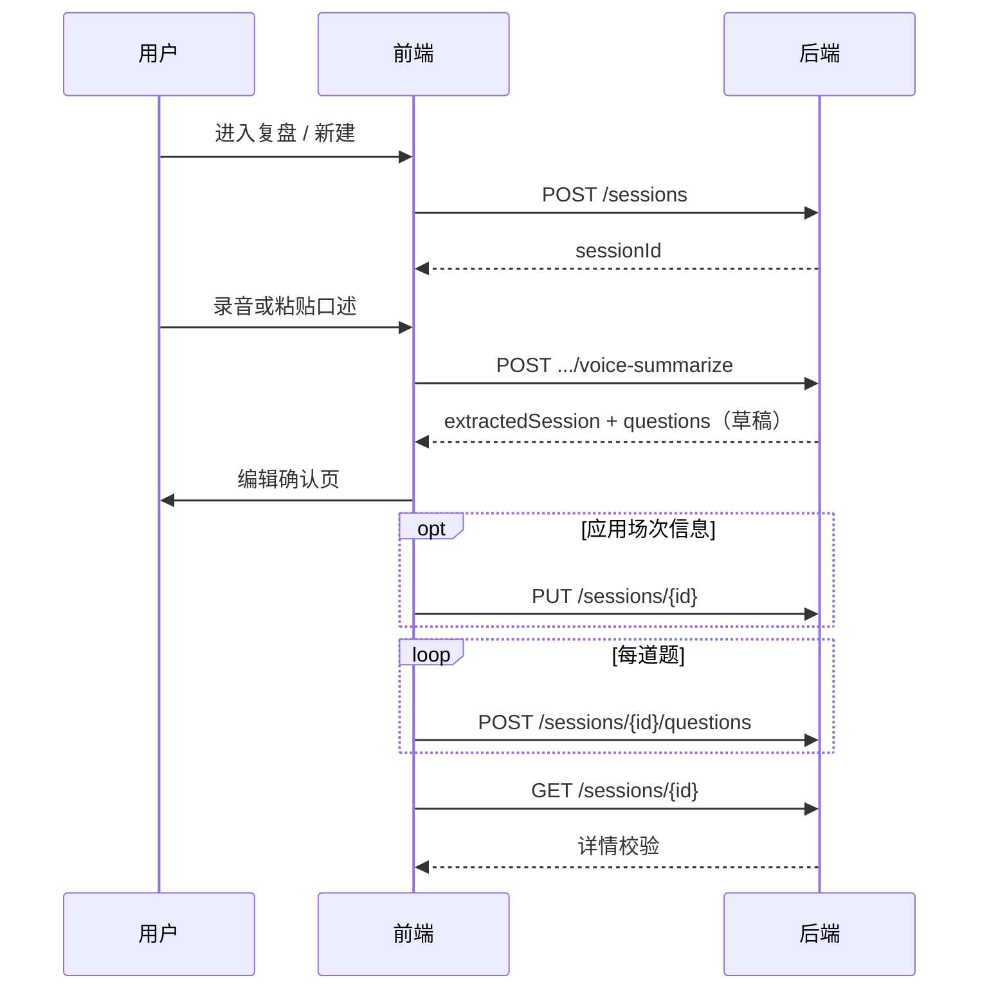

# 面试复盘模块 · 前端对接说明

面向 **正式客户端**（桌面 / 手机 App），**不**走插件端 `/api/v1/plugin`。

---

## 1. 环境与 Base URL

| 项 | 值 |
|----|-----|
| 进程 | `ida-app-server`（与插件进程分离） |
| 默认端口 | `8088`（环境变量 `APP_SERVER_PORT` 可覆盖） |
| API 前缀 | `/api/v1/app` |
| 面试复盘 Base | **`/api/v1/app/interview`** |
| 完整示例 | `http://localhost:8088/api/v1/app/interview` |

本地联调可用 Knife4j：`http://localhost:8088/doc.html`，分组选 **「正式客户端」**（`app`）。

---

## 2. 鉴权

### 2.1 推荐：Bearer Token

1. 短信登录：`POST /api/v1/app/auth/sms/login`
2. 保存响应 `data.token`
3. 后续请求头：

```http
Authorization: Bearer <token>
```

前缀必须为 `Bearer `（注意末尾空格），与后端 `ida.auth.session.bearer-prefix` 一致。

登录响应 `data` 字段：

| 字段 | 类型 | 说明 |
|------|------|------|
| `token` | string | 会话令牌 |
| `userId` | number | 用户主键 |
| `newUser` | boolean | 是否本次新注册用户 |
| `expiresInSeconds` | number | 建议客户端展示的剩余有效期（秒），默认约 7 天 |

### 2.2 调试（仅开发）

无 Token 时可传：

```http
X-User-Id: <数字用户 id>
```

生产环境应关闭或仅在可信网关后使用。

### 2.3 未登录

面试复盘全部接口要求 `@RequestUserId(required = true)`。无有效身份时 HTTP **401**，body 可能为 Spring 默认错误体（非 `ResponseDTO`）。前端应在 401 时跳转登录。

---

## 3. 统一响应体 `ResponseDTO`

所有业务接口 JSON 形如：

```json
{
  "code": 0,
  "ok": true,
  "success": true,
  "msg": "操作成功",
  "message": "操作成功",
  "data": { }
}
```

| 字段 | 说明 |
|------|------|
| `code` | `0` 成功；非 0 为业务/系统错误码 |
| `ok` / `success` | 等价，成功为 `true` |
| `msg` / `message` | 等价，提示文案 |
| `data` | 业务载荷；无数据时可能为 `null` |

**前端判断成功**：`code === 0` 或 `ok === true`（建议以 `code === 0` 为准）。

参数校验失败：`code` 为用户错误码，`msg` 为拼接后的字段提示（如「复盘标题不能为空」）。

业务异常（如「复盘不存在或无权访问」）：`BusinessException` 文案在 `msg` 中。

---

## 4. 接口一览

| 方法 | 路径 | 说明 |
|------|------|------|
| GET | `/sessions` | 当前用户的复盘场次列表 |
| GET | `/sessions/{sessionId}` | 场次详情 + 问题列表 |
| POST | `/sessions` | 新建场次 |
| PUT | `/sessions/{sessionId}` | 更新场次元信息（部分字段） |
| DELETE | `/sessions/{sessionId}` | 删除场次（级联软删问题） |
| POST | `/sessions/{sessionId}/questions` | 新增一道题 |
| PUT | `/sessions/{sessionId}/questions/{questionId}` | 更新题目 |
| DELETE | `/sessions/{sessionId}/questions/{questionId}` | 删除题目 |
| POST | `/sessions/{sessionId}/voice-summarize` | AI 总结（**不入库**，仅草稿） |

路径均相对于 Base：`/api/v1/app/interview`。

---

## 5. 数据模型

### 5.1 场次列表项 `InterviewSessionListItemVO`

`GET /sessions` → `data` 为 **数组**。

| 字段 | 类型 | 说明 |
|------|------|------|
| `sessionId` | number | 场次 id |
| `title` | string | 标题 |
| `companyName` | string \| null | 公司 |
| `positionName` | string \| null | 岗位 |
| `interviewRound` | string \| null | 轮次，如「一面」 |
| `interviewAt` | string \| null | 面试日期 **`YYYY-MM-DD`** |
| `questionCount` | number | 未删除问题条数（冗余字段） |
| `updatedAt` | string | ISO 本地时间，如 `2026-06-02T15:30:00` |

列表按 `updatedAt` **降序**（最近更新在前）。**无分页**，V1 返回全量。

### 5.2 场次详情 `InterviewSessionDetailVO`

`GET /sessions/{sessionId}` → `data` 为对象，字段与列表项类似，并含：

| 字段 | 类型 | 说明 |
|------|------|------|
| `questions` | array | `InterviewQuestionVO[]`，按 `sortOrder` 升序 |

### 5.3 问题 `InterviewQuestionVO`

| 字段 | 类型 | 说明 |
|------|------|------|
| `questionId` | number | 问题 id |
| `sessionId` | number | 所属场次 |
| `sortOrder` | number | 排序，从 1 递增 |
| `question` | string | 题干 |
| `myAnswer` | string \| null | 我的回答 |
| `answerEvaluation` | string \| null | 回答评价 |
| `referenceAnswer` | string \| null | 参考答案 |
| `otherNotes` | string \| null | 其它备注 |
| `createdAt` / `updatedAt` | string | 时间戳 |

### 5.4 日期格式

- 请求体中的 `interviewAt`：**必须** `YYYY-MM-DD`，否则 400/业务错误「面试日期格式应为 YYYY-MM-DD」。
- 响应中的 `interviewAt`：同上字符串或 `null`。

---

## 6. 请求体说明

### 6.1 新建场次 `POST /sessions`

`Content-Type: application/json`

```json
{
  "title": "字节后端一面",
  "companyName": "字节跳动",
  "positionName": "后端开发",
  "interviewRound": "一面",
  "interviewAt": "2026-06-02"
}
```

| 字段 | 必填 | 约束 |
|------|------|------|
| `title` | 是 | 非空，最长 80 字 |
| 其余 | 否 | 可省略或 `null` |

响应 `data`：

```json
{ "sessionId": 123 }
```

### 6.2 更新场次 `PUT /sessions/{sessionId}`

**部分更新（PATCH 语义）**：请求体里 **为 `null` 的字段表示不修改**（JSON 里未传的属性反序列化后也是 `null`）。

```json
{
  "title": "字节跳动 · 后端 · 一面",
  "companyName": "字节跳动",
  "positionName": "后端开发",
  "interviewRound": "一面",
  "interviewAt": "2026-06-02"
}
```

- `title`：仅当非 `null` 且 **有非空白字符** 时才更新。
- 其它字符串字段：传 `null` 不更新；传 `""` 会清空为 `null`（经 `trimNullable`）。

成功 `data` 为字符串 `"ok"`（可忽略，看 `code` 即可）。

**注意**：`voice-summarize` 返回的 `extractedSession` **不会自动写库**，需用户确认后调用本接口（见第 8 节）。

### 6.3 新增问题 `POST /sessions/{sessionId}/questions`

```json
{
  "question": "请介绍你的核心项目",
  "myAnswer": "我做了订单模块…",
  "answerEvaluation": "结构清晰，可补充量化指标",
  "referenceAnswer": "STAR 法则…",
  "otherNotes": null,
  "sortOrder": 1
}
```

| 字段 | 必填 | 说明 |
|------|------|------|
| `question` | 是 | 非空 |
| `sortOrder` | 否 | 不传则追加到当前最大序号 + 1 |

响应：

```json
{ "questionId": 456 }
```

保存后服务端会刷新场次的 `questionCount` 与 `updatedAt`。

### 6.4 更新问题 `PUT /sessions/{sessionId}/questions/{questionId}`

与更新场次相同：**仅非 `null` 字段生效**；`question` 需非空白才更新。

### 6.5 删除

- 删除场次：软删该场次及下属全部问题。
- 删除问题：软删单题并回写 `questionCount`。

成功 `data` 均为 `"ok"`。

---

## 7. AI 总结 `voice-summarize`（核心）

`POST /sessions/{sessionId}/voice-summarize`

**重要**：本接口 **只返回 AI 草稿，不写数据库**。前端展示编辑页，用户确认后再 `POST .../questions` / `PUT .../sessions`。

### 7.1 两种调用方式

#### A. JSON（纯文本 / 端上转写）

```http
Content-Type: application/json
```

```json
{
  "rawTranscript": "今天面试了字节的后端一面，问了项目…"
}
```

无录音文件时使用。

#### B. Multipart（录音 + 可选转写）

```http
Content-Type: multipart/form-data
```

| 表单项 | 类型 | 必填 | 说明 |
|--------|------|------|------|
| `file` | 文件 | 否 | 录音（webm/m4a/mp3 等） |
| `rawTranscript` | 字符串 | 否 | 浏览器/系统实时转写全文 |

服务端逻辑（前端需理解）：

1. `rawTranscript` 去空白后长度 **≥ 10**（`ida.speech-to-text.min-transcript-chars`）→ **直接用文稿**，不上传听写。
2. 否则若存在 `file` → 调用 **Whisper** 听写（需配置 `OPENAI_API_KEY`）。
3. 仍无有效文本 → 错误：「无法识别语音，请重录或改用文字」。

**手机 App 建议**：

- 端上 STT 质量好：传足够长的 `rawTranscript`，可不上传 `file`。
- 或只上传 `file`，`rawTranscript` 留空，走服务端 Whisper。
- 或双传：短稿 + 音频备份。

上传限制（`ida-app-server`）：单文件最大 **15MB**，整请求 **16MB**。

### 7.2 响应 `InterviewVoiceSummarizeResultVO`

```json
{
  "code": 0,
  "ok": true,
  "data": {
    "hint": null,
    "extractedSession": {
      "companyName": "字节跳动",
      "positionName": "后端开发",
      "interviewRound": "一面",
      "interviewAt": "2026-06-02",
      "suggestedTitle": "字节跳动 · 后端开发 · 一面"
    },
    "questions": [
      {
        "question": "请介绍核心项目",
        "myAnswer": "…",
        "answerEvaluation": "…",
        "referenceAnswer": "…",
        "otherNotes": "…"
      }
    ],
    "question": "请介绍核心项目",
    "myAnswer": "…",
    "answerEvaluation": "…",
    "referenceAnswer": "…",
    "otherNotes": "…"
  }
}
```

| 字段 | 说明 |
|------|------|
| `hint` | 模型无法拆题或需提示用户时的说明；非空时应展示给用户 |
| `extractedSession` | 从口述抽取的场次信息草稿 |
| `questions` | **主字段**：多道题数组 |
| 顶层 `question` / `myAnswer` / … | **兼容旧版**：与 `questions[0]` 同步，新前端请 **只读 `questions`** |

`extractedSession` 各字符串：口述未提及时可能为 `""` 或 `null`，展示前请 `trim` 判断。

AI 失败（余额、超时等）：`code !== 0`，`msg` 为错误说明。

---

## 8. 推荐业务流程



### 8.1 列表页

1. `GET /sessions` 渲染卡片（标题、公司、题数、更新时间）。
2. 点击进入详情：`GET /sessions/{id}`。

### 8.2 新建 + 语音总结

1. 可先 `POST /sessions`（标题可临时如「未命名复盘」），或先总结再创建（需先有 `sessionId`，总结接口依赖已存在场次）。
2. 调用 `voice-summarize`。
3. 用 `extractedSession` 预填表单；`suggestedTitle` 可一键填入 `title`。
4. 用户确认后 `PUT /sessions/{id}`。
5. 对 `data.questions` 逐条 `POST .../questions`（可带 `sortOrder` 为数组下标 + 1）。
6. `GET /sessions/{id}` 核对。

### 8.3 仅手动录入

跳过 `voice-summarize`，直接 `POST .../questions` 或详情页内编辑后 `PUT`。

### 8.4 编辑 / 删除

- 改场次：`PUT /sessions/{id}`
- 改单题：`PUT .../questions/{questionId}`
- 删题 / 删场次：`DELETE` 对应路径

---

## 9. 前端实现要点

### 9.1 Axios 示例（JSON 总结）

```typescript
const base = '/api/v1/app/interview';

async function voiceSummarizeJson(sessionId: number, rawTranscript: string) {
  const { data } = await axios.post(
    `${base}/sessions/${sessionId}/voice-summarize`,
    { rawTranscript },
    {
      headers: {
        Authorization: `Bearer ${token}`,
        'Content-Type': 'application/json',
      },
      timeout: 120_000, // AI 可能较慢
    },
  );
  if (data.code !== 0) throw new Error(data.msg);
  return data.data as InterviewVoiceSummarizeResultVO;
}
```

### 9.2 Multipart 示例

```typescript
const form = new FormData();
if (audioFile) form.append('file', audioFile);
if (transcript) form.append('rawTranscript', transcript);

await axios.post(`${base}/sessions/${sessionId}/voice-summarize`, form, {
  headers: { Authorization: `Bearer ${token}` },
  timeout: 120_000,
});
```

不要手动设置 `Content-Type`，由浏览器带上 `boundary`。

### 9.3 TypeScript 类型（建议）

与后端 VO 对齐，`questions` 使用数组类型；勿依赖顶层五字段。

### 9.4 错误与重试

| 场景 | 建议 |
|------|------|
| 401 | 清 Token，跳转登录 |
| 听写失败 | 提示改文字输入或检查服务端 Whisper 配置 |
| AI 402/5xx | 展示 `msg`，允许用户手动编辑后保存 |
| 删除后 | 列表移除该 `sessionId`；详情页返回列表 |

---

## 10. 与登录接口的配合

| 接口 | 路径 | 需登录 |
|------|------|--------|
| 发验证码 | `POST /api/v1/app/auth/sms/send-code` | 否 |
| 登录 | `POST /api/v1/app/auth/sms/login` | 否 |
| 退出 | `POST /api/v1/app/auth/sms/logout` | 是（Bearer） |

发码请求体：`{ "phone": "13800138000" }`  
登录请求体：`{ "phone": "13800138000", "code": "123456" }`

---

## 11. 常见问题

**Q：必须先创建场次才能总结吗？**  
A：是。`voice-summarize` 路径含 `sessionId`，且会校验归属。

**Q：`questionCount` 何时变化？**  
A：增删问题后服务端自动维护；不要由前端自行累加写库。

**Q：更新场次时如何「清空」公司名？**  
A:`PUT` 传 `"companyName": ""`（空串），会存为 `null`。不传该字段则不变。

**Q：插件端能用这些接口吗？**  
A：不能。插件走 `/api/v1/plugin`，面试复盘仅在 **app** 进程实现。

**Q：有没有批量保存多题接口？**  
A：V1 无 `questions/batch`，需循环 `POST .../questions`。

---

## 12. 变更记录

| 版本 | 说明 |
|------|------|
| V1 | 场次 CRUD、问题 CRUD、`voice-summarize` 多题 + `extractedSession` |
| 列表 | 无分页 |
| 保存 | AI 结果需用户确认后显式调用写接口 |

更多 Apifox 用例见：`docs/interview-api-testcases.md`。
