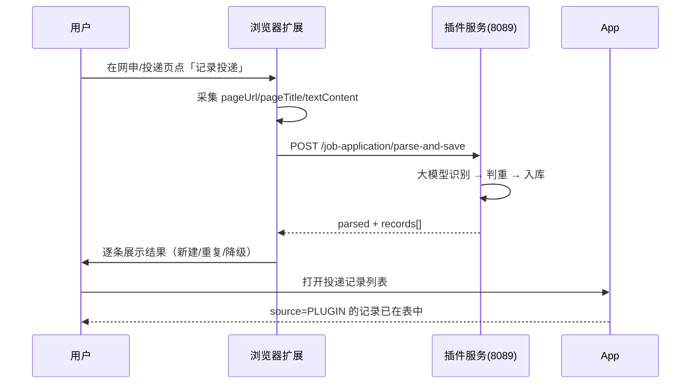

# 投递记录识别入库 · 插件端对接说明

面向 **浏览器扩展**（插件端进程 `ida-plugin-server`），**不**走 APP 端 `/api/v1/app`。

功能定位：用户在网申/投递页面点击扩展的「记录投递」按钮，扩展采集页面快照上传，服务端用大模型识别页面中的投递信息并自动入库；用户在 App 端的投递记录列表中即可看到（`source = PLUGIN`）。

配套阅读：`docs/job-application-frontend-integration.md`（App 端投递记录 CRUD 与展示）。

---

## 1. 环境与 Base URL

| 项 | 值 |
|----|-----|
| 进程 | `ida-plugin-server`（与 APP 进程分离） |
| 默认端口 | `8089`（环境变量 `PLUGIN_SERVER_PORT` 可覆盖） |
| API 前缀 | `/api/v1/plugin` |
| 本功能 Base | **`/api/v1/plugin/job-application`** |
| 完整示例 | `http://localhost:8089/api/v1/plugin/job-application` |

本地联调可用 Knife4j：`http://localhost:8089/doc.html`，分组选 **「插件端-投递记录」**。

---

## 2. 鉴权

1. 短信登录：`POST /api/v1/plugin/auth/sms/login`，保存响应 `data.token`
2. 后续请求头：

```http
Authorization: Bearer <token>
```

插件端与 APP 端登录态独立签发，但对应**同一个用户**——插件入库的记录在 APP 端用同一账号即可看到。

本地开发环境可用模拟号 `13800000000` / 验证码 `246810` 直接登录（`mock-code-enabled` 仅 dev 开启）。

未登录或 token 失效：HTTP **401**，扩展应引导重新登录。

---

## 3. 统一响应体 `ResponseDTO`

```json
{
  "code": 0,
  "ok": true,
  "success": true,
  "msg": "操作成功",
  "message": "操作成功",
  "data": { }
}
```

- **判断成功**：`code === 0`。
- 参数校验失败：`code = 30001`，`msg` 为字段提示（如「网申地址不能为空」）。
- 业务异常：`code = 30100`，`msg` 为业务文案；**额度不足等计费异常**也会以业务错误返回（此时不入库，扩展应提示用户）。

---

## 4. 接口一览

| 方法 | 路径 | 说明 |
|------|------|------|
| POST | `/job-application/parse-and-save` | 识别当前页面投递信息并入库（同步返回） |

路径相对于 Base：`/api/v1/plugin`。

---

## 5. 识别入库 `POST /job-application/parse-and-save`

### 5.1 请求体

`Content-Type: application/json`

```json
{
  "pageUrl": "https://jobs.bytedance.com/campus/position/700123/detail",
  "pageTitle": "后端开发工程师-校园招聘-职位详情-字节跳动",
  "textContent": "字节跳动 校园招聘 后端开发工程师-基础架构 职位描述 1、负责..."
}
```

| 字段 | 必填 | 约束 | 说明 |
|------|------|------|------|
| `pageUrl` | 是 | 非空白，≤512 字 | 当前页 `location.href`，**是判重键的一部分**，必须原样上传 |
| `pageTitle` | 否 | ≤256 字 | `document.title`，识别公司/岗位的强信号，建议始终提供 |
| `textContent` | 否 | 无硬限制 | 页面正文快照，服务端按配置（默认 8000 字符）截断 |

**扩展采集建议**：

- `textContent` 取正文区域（去 `script/style/nav/footer` 后的 `innerText`），不必整页 DOM；
- 扩展侧可先做粗截断（如 10000 字符）再上送，减少无效流量；服务端仍会兜底截断；
- URL 与标题对识别质量影响很大，即使正文拿不到也应尽量带上。

### 5.1.1 扩展侧要做什么（实现清单）

整个功能里服务端只认三个字段，**采集质量全部取决于扩展**。扩展侧要完成的事：

1. **判断按钮展示时机**：在招聘/投递相关页面才注入「记录投递」按钮（可复用一键填表的站点识别逻辑，或先用 URL 关键字白名单：`/job/`、`/position/`、`/apply/`、`/campus/`、`/zhaopin/` 等）。
2. **采集页面快照**（content script，参考实现如下）：
   - `pageUrl`：`location.href` 原样（如能剥离纯跟踪参数如 `from`/`spm`/`timestamp` 更好，判重更稳，但不处理也能用）；
   - `pageTitle`：`document.title`；
   - `textContent`：克隆 `<body>` → 移除 `script/style/noscript/nav/footer/header/aside` 及隐藏元素 → 取 `innerText` → 压缩连续空白 → 截断到约 10000 字符。
3. **调接口**：点击后进入 loading 态（防连点），把快照发给 `parse-and-save`（超时 ≥ 30s，建议 60s）。
4. **渲染结果**：按 5.3 的三种场景逐条展示。
5. **处理 401**：token 失效时引导重新登录（插件端 `/api/v1/plugin/auth/sms/login`）。

快照采集参考代码（content script）：

```typescript
function capturePageSnapshot(maxChars = 10_000) {
  const clone = document.body.cloneNode(true) as HTMLElement;
  clone
    .querySelectorAll('script, style, noscript, nav, footer, header, aside, [hidden], [aria-hidden="true"]')
    .forEach((el) => el.remove());
  const text = (clone.innerText || '')
    .replace(/\s+/g, ' ')   // 压缩连续空白，减少 token 浪费
    .trim()
    .slice(0, maxChars);
  return {
    pageUrl: location.href,
    pageTitle: document.title,
    textContent: text,
  };
}
```

MV3 结构下注意：content script 直接调接口会遇到 CORS 和 token 存储问题，推荐做法是 content script 只采集快照，通过 `chrome.runtime.sendMessage` 交给 background service worker 发请求（token 也存 background 侧）。

### 5.2 响应 `PluginJobApplicationParseResultVO`

```json
{
  "code": 0,
  "data": {
    "parsed": true,
    "records": [
      {
        "applicationId": 10,
        "companyName": "字节跳动",
        "position": "后端开发工程师-基础架构",
        "applyDate": "2026-10-10",
        "progress": "SCREENING",
        "applyUrl": "https://jobs.bytedance.com/campus/position/700123/detail",
        "duplicated": false
      }
    ]
  }
}
```

| 字段 | 类型 | 说明 |
|------|------|------|
| `parsed` | boolean | **大模型是否成功产出结构化结果**。`false` = 已降级为仅存档网址+标题（记录照样入库，公司/岗位为空，待用户在 APP 补全） |
| `records` | array | 本次处理的**全部**记录（含新建与判重命中），顺序与页面识别顺序一致 |
| `records[].applicationId` | number | 记录 id；`duplicated=true` 时为**已有**记录的 id |
| `records[].companyName` / `position` | string | 识别结果；降级存档时为空串 |
| `records[].applyDate` | string | `YYYY-MM-DD`；页面无明确投递日期时默认当天 |
| `records[].progress` | string | 进度 code（取值与 APP 端枚举一致，见下）；模型无法判断时默认 `APPLIED` |
| `records[].applyUrl` | string | 即请求的 `pageUrl` |
| `records[].duplicated` | boolean | `true` = 与已有记录重复，本次**未新建**（判重键：用户 + 网址 + 公司 + 岗位） |

### 5.3 三种典型场景与 UI 建议

**① 识别成功（`parsed=true`）**——逐条展示识别结果，例如 toast/弹层：

```
✅ 已记录：字节跳动 · 后端开发工程师-基础架构
```

**② 部分或全部重复（`duplicated=true`）**——该条标记「之前已记录过」，可附 `applicationId` 做"去 App 查看"跳转：

```
✅ 已记录：腾讯 · 后台开发-PCG
⏭ 之前已记录：腾讯 · 客户端开发-微信事业群
```

接口是幂等的：同一页面重复点击不会产生重复数据，扩展**无需**自己做防重。

**③ 降级存档（`parsed=false`）**——明确告知用户"只存了链接"，引导去 APP 补全：

```
⚠️ 未能识别页面内容，已为你保存网址，可在 App 中补充公司和岗位
```

`parsed=false` 出现在两种情况：页面里确实没有投递信息（如 404 页）、或大模型调用失败。**入库一定成功**（HTTP 200 且 `code=0`），不要因为 `parsed=false` 当成失败重试。

### 5.4 一页多记录

投递**列表页**（如"我的投递记录"页）一次调用可识别多条，`records` 按页面顺序返回多条，每条独立标记新建/重复。扩展按数组逐条渲染即可，无需特殊处理。

### 5.5 错误场景速查

| 场景 | code | 扩展处理 |
|------|------|----------|
| 未登录 / token 失效 | HTTP 401 | 引导重新登录 |
| `pageUrl` 缺失或超长 | 30001 | 检查采集逻辑（属扩展 bug，不应出现） |
| 额度不足等计费异常 | 30100 | 展示 `msg`，提示去 App 充值/稍后再试 |
| 大模型失败 | **无错误**，`parsed=false` | 按降级场景提示（见 5.3③） |
| HTTP 5xx / 网络错误 | — | 提示"记录失败，请重试"，可安全重试（幂等） |

### 5.6 进度枚举

`progress` 取值与 APP 端一致：`APPLIED / ASSESSMENT / SCREENING / RESCREEN / WRITTEN_TEST / INTERVIEW_1 / INTERVIEW_2 / FINAL_INTERVIEW / OFFER / TERMINATED`。中文文案可向 APP 端 `GET /api/v1/app/job-application/progress-options` 获取；扩展侧如需展示建议内置一份映射（插件端无此接口）。

---

## 6. 推荐交互流程



按钮展示时机：建议复用一键填表的站点识别逻辑，仅在招聘/投递相关站点显示「记录投递」入口。

---

## 7. Axios 示例

```typescript
const base = '/api/v1/plugin/job-application';

interface ParseItem {
  applicationId: number;
  companyName: string;
  position: string;
  applyDate: string;
  progress: string;
  applyUrl: string;
  duplicated: boolean;
}

interface ParseResult {
  parsed: boolean;
  records: ParseItem[];
}

async function parseAndSave(snapshot: {
  pageUrl: string;
  pageTitle?: string;
  textContent?: string;
}): Promise<ParseResult> {
  const { data } = await axios.post(`${base}/parse-and-save`, snapshot, {
    headers: { Authorization: `Bearer ${token}` },
    timeout: 60_000, // 大模型调用，给足超时
  });
  if (data.code !== 0) throw new Error(data.msg);
  return data.data as ParseResult;
}
```

注意：同步接口，大模型调用通常 2~10 秒，按钮点击后请给 loading 态，`timeout` 不要小于 30 秒。

---

## 8. 常见问题

**Q：同一页面用户连点多次会产生重复数据吗？**  
A：不会。服务端按「用户 + 网址 + 公司 + 岗位」判重，重复的条目标记 `duplicated=true` 返回，不新建。扩展无需防抖之外的任何防重逻辑（防连点 loading 即可）。

**Q：判重会覆盖用户在 App 里改的进度吗？**  
A：不会。判重命中时服务端只读不写，用户手动维护的 `progress`/`remark` 安全。

**Q：`parsed=false` 要提示用户重试吗？**  
A：不要。降级存档也是成功结果（网址已入库）。页面无投递信息时重试一百次也是 `parsed=false`；大模型故障时重试才有意义，但应由用户自己决定。

**Q：识别的进度可信吗？**  
A：模型从页面文本判断（如"简历筛选中"→`SCREENING"），全部落在合法枚举内，非法值服务端会兜底为 `APPLIED`。但终归是推断，用户在 App 端可随时改。

**Q：URL 带跟踪参数会影响判重吗？**  
A：当前判重用 `pageUrl` 精确匹配，`?from=xxx` 这类参数变化会被视为不同记录。扩展如能剥离无效 query 参数（只留岗位 id 类参数）再上送，判重更稳；不处理也能正常工作。

**Q：记录在哪看？**  
A：App 端投递记录列表（`GET /api/v1/app/job-application`），`source=PLUGIN` 标识插件入库，见 `docs/job-application-frontend-integration.md`。

---

## 9. 变更记录

| 版本 | 说明 |
|------|------|
| V1 | 单接口 `parse-and-save`：多记录识别、四元组判重、降级存档、计费（识别失败不扣点） |
